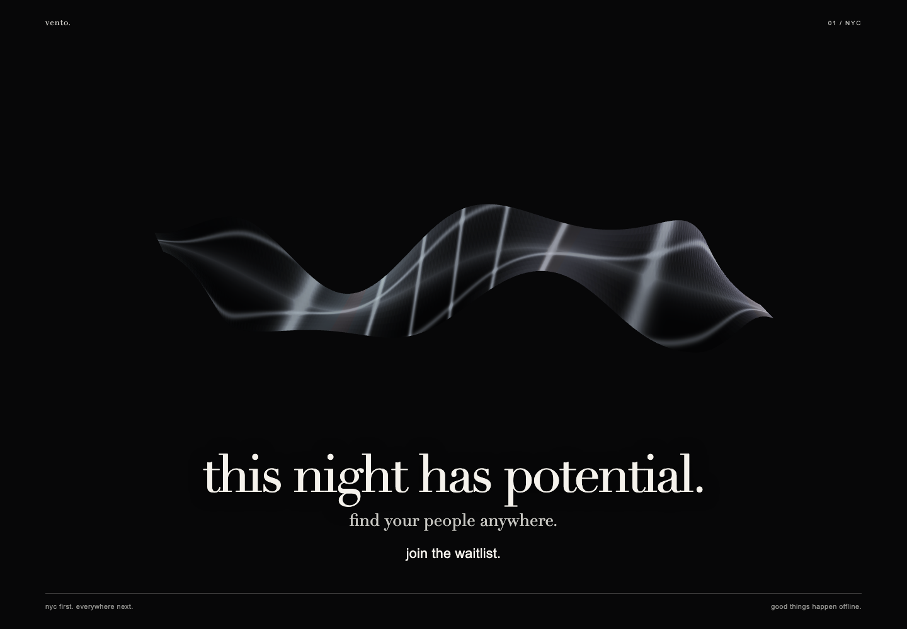

# Liquid Sculpture Implementation Evidence

Date: 2026-10-15

## Automated verification

- `npm run verify`: lint, typecheck, six unit tests, and production build passed.
- `CI=1 npm run test:e2e`: fourteen Chromium tests passed across desktop and mobile projects.
- The E2E suite explicitly covers the live/fallback renderer state, forced static fallback, reduced motion, horizontal overflow, waitlist submission, messages, and onboarding handoff.

## Visual verification

The implementation capture below was produced from the local production build at 1440 × 1000. It verifies the final editorial hierarchy, live ribbon placement, exact hero copy, navigation, footer, and viewport fit.

A 12-second interaction recording was also captured locally to verify continuous shader motion and pointer response. Video output remains a test artifact rather than a tracked repository binary.

## Remaining acceptance gates

- Compare against the owner-provided reference screenshots when they are added to the repository.
- Add and validate the four licensed nightlife clips described in `public/media/nightlife/manifest.json`.
- Capture performance and reduced-motion behavior on a physical iPhone before declaring the visual system production-final.
